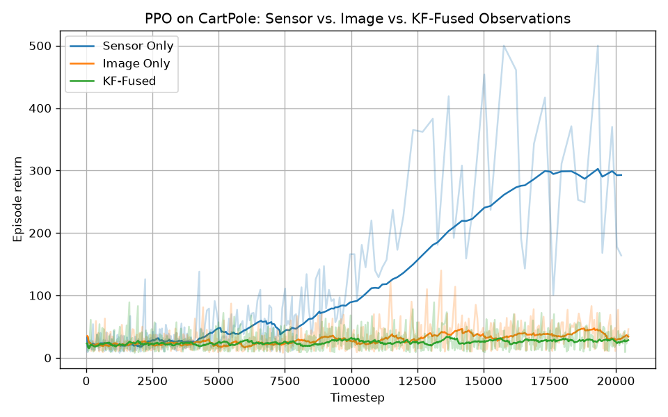
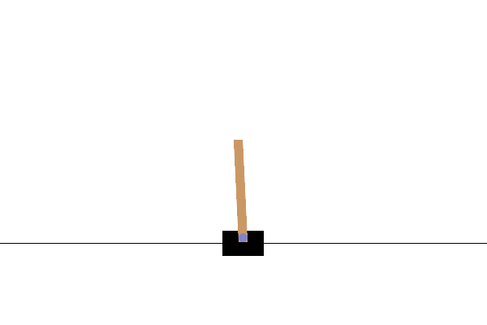
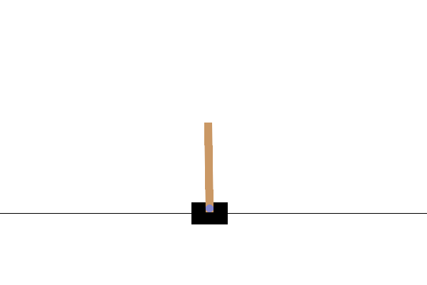

# Baselines: PPO on CartPole-v1

Generated by `src/baselines/train.py` (20,000 timesteps per agent, 1 seed, default SB3 PPO hyperparameters).

| Agent | Episodes | Return (last 20 eps, mean ± std) | Best return | Wall time (min) |
|---|---|---|---|---|
| Sensor Only | 317 | 292.8 ± 126.1 | 500 | 0.1 |
| Image Only | 732 | 34.1 ± 13.4 | 140 | 2.6 |
| KF-Fused | 825 | 28.4 ± 8.9 | 89 | 1.0 |

Max possible return is 500.

## Demos (greedy policy, 1 episode each)

| Sensor Only | Image Only | KF-Fused |
|---|---|---|
|  |  |  |

Run: `srep-venv/bin/python src/baselines/train.py` (from the repo root). The live plot `plots/live_training.png` is redrawn every 2k steps during training.

- **Sensor Only**: 4D CartPole state.
- **Image Only**: 64x64 grayscale render, `CnnPolicy`. A single frame has no velocity information.
- **KF-Fused**: Kalman filter over the sensor state and a *fixed random projection* of a 32x32 render (fixed Q/R, no learned gain).

## Takeaways (run of 2026-10-23)

- **Sensor Only** learns CartPole within 20k steps (~300 mean, hits 500).
- **Image Only** barely learns (~34). A single frame carries no velocity information, and 20k steps is too few for a CNN. Frame stacking and more steps are needed for a fair baseline.
- **KF-Fused is worse than sensor-only (~28)**, even though it receives the same sensor state. The random image projection is fed to the filter as a direct measurement of the state, and with equal noise R the filter averages the true state with noise. This is the motivation for *learning* the gain and the image encoder.
