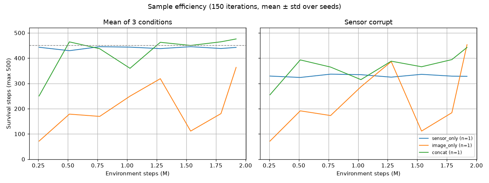
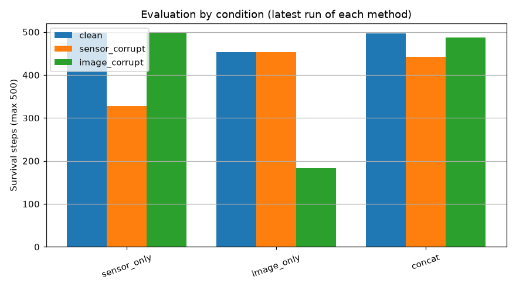
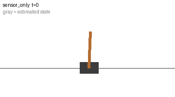
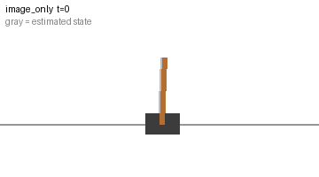
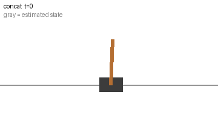

# Fusion via differentiable simulation (CartPole, JAX)

Sensor state and rendered frames are fused by a learned module and trained **end to end**: the return is backpropagated through the JAX CartPole simulator, the soft renderer and the fusion module (short-horizon analytic policy gradients). Generated by `src/fusion_e2e/train.py`.

## Setup

- **Env**: CartPole dynamics with continuous force, 200-step training episodes, 25-step gradient windows, 64 parallel envs.
- **Observations**: noisy 4D sensor state (σ = 0.02 × scale) and two stacked 32×32 soft-rendered frames with pixel noise.
- **Corruption**: during a window the sensor noise jumps to σ = 1.0 × scale (*sensor_corrupt*) or the frame becomes 85% noise (*image_corrupt*). Training samples a random mode and window per env.
- **Eval**: survival steps out of 500 (pole within 12°, cart within 2.4), 64 envs, corruption window steps 150–350.
- **Loss**: −reward + 0.5 × state-estimation MSE (true state is free in simulation) + 0.1 × Gaussian NLL of predicted variances.

## Methods

| Method | Description |
|---|---|
| `sensor_only` | Noisy sensor state only, no image. |
| `image_only` | CNN on 2 stacked frames only, no sensor. |
| `concat` | Concatenate sensor state and CNN latent; the policy MLP does the fusion. |
| `fixed_kf` | Kalman filter with fixed hand-set Q/R (constant gain), learned linear dynamics + CNN measurement. |
| `gated` | Gated latent fusion: g * enc(sensor) + (1 - g) * enc(image), g learned per feature. |
| `gru` | Recurrent belief: GRU over [sensor, CNN latent]. |
| `poe` | Product of experts: precision-weighted average of sensor and image estimates, both variances predicted by networks (no dynamics). |
| `learned_kf` | Differentiable Kalman filter, learned linear dynamics; sensor and image measurement noise predicted per step by networks, so the gain adapts (recommended method). |

## Equations

**Simulator and observations.** State $s_t = [x, \dot x, \theta, \dot\theta]$, normalized by $S = \mathrm{diag}(1, 1, 0.2, 1)$.

$$s_{t+1} = f(s_t, u_t) \quad \text{(CartPole, Euler, } \Delta t = 0.02\text{)}, \qquad u_t \in [-1, 1]$$

$$z_t = s_t + \sigma_t S \epsilon_t, \quad \epsilon_t \sim \mathcal N(0, I), \quad \sigma_t \in \{0.02 \text{ (nominal)},\ 1.0 \text{ (sensor corrupt)}\}$$

$$o_t = \mathrm{render}(s_t) + \text{noise} \quad \text{(soft, differentiable; 85\% uniform noise when image corrupt)}$$

**Image encoder** (two stacked frames give velocity):

$$(h_t,\ \mu^{img}_t,\ \log v^{img}_t) = \mathrm{CNN}([o_t, o_{t-1}])$$

**Fusion methods** ($\phi_t$ is the policy input):

| Method | Fusion |
|---|---|
| `sensor_only` | $\phi_t = S^{-1} z_t$ |
| `image_only` | $\phi_t = h_t$ |
| `concat` | $\phi_t = [S^{-1} z_t,\ h_t]$ |
| `gated` | $g_t = \sigma(W[e(z_t), h_t]),\quad \phi_t = g_t \odot e(z_t) + (1 - g_t) \odot h_t$ |
| `gru` | $b_t = \mathrm{GRU}(b_{t-1}, [S^{-1} z_t, h_t]),\quad \phi_t = b_t$ |
| `poe` | $\hat x_t = \dfrac{z_t / v^s_t + \mu^{img}_t / v^{img}_t}{1 / v^s_t + 1 / v^{img}_t},\quad v^s_t = S^2 \exp \mathrm{NN}_s([z_t,\ z_t - \mu^{img}_t])$ |
| `fixed_kf`, `learned_kf` | Kalman filter below |

**Kalman filter** with learned linear dynamics $(A, B)$:

$$\hat x^-_t = A \hat x_{t-1} + B u_{t-1}, \qquad P^-_t = A P_{t-1} A^\top + Q$$

$$P_t = \left( (P^-_t)^{-1} + R_{s,t}^{-1} + R_{i,t}^{-1} \right)^{-1}, \qquad \hat x_t = P_t \left( (P^-_t)^{-1} \hat x^-_t + R_{s,t}^{-1} z_t + R_{i,t}^{-1} \mu^{img}_t \right)$$

Equivalently, with gains $K_{s,t} = P_t R_{s,t}^{-1}$ and $K_{i,t} = P_t R_{i,t}^{-1}$:

$$\hat x_t = (I - K_{s,t} - K_{i,t})\, \hat x^-_t + K_{s,t}\, z_t + K_{i,t}\, \mu^{img}_t$$

- `fixed_kf`: $Q, R_s, R_i$ are fixed constants, so the gains converge to constants.
- `learned_kf`: the noise is predicted at every step, so the gains adapt to the inputs:

$$R_{s,t} = S^2 \mathrm{diag}\, \exp \mathrm{NN}_s([z_t - \hat x^-_t,\ z_t - \mu^{img}_t]), \qquad R_{i,t} = \mathrm{diag}(v^{img}_t), \qquad Q = S^2 \mathrm{diag}\, e^{q}$$

The plotted *weight on sensor* is $\overline{\mathrm{diag}}(K_{s,t})$ (for `poe`, $v^{img} / (v^s + v^{img})$; for `gated`, $\bar g_t$). For estimator methods, $\phi_t = [S^{-1} \hat x_t,\ 0.1 \log(\mathrm{diag}\, P_t / S^2)]$.

**Policy, reward, loss.**

$$u_t = \tanh \pi_\theta(\phi_t), \qquad r_t = 1 - \left(\frac{\theta_t}{\theta_{max}}\right)^2 - 0.5 \left(\frac{x_t}{x_{max}}\right)^2 - 0.01 (\dot x_t^2 + \dot\theta_t^2) - 0.01 u_t^2$$

$$\mathcal L = -\frac{1}{HN} \sum_{t,n} r_t \;+\; \lambda_{aux} \sum_t \left( \lVert S^{-1}(\hat x_t - s_t) \rVert^2 + \lVert S^{-1}(\mu^{img}_t - s_t) \rVert^2 \right) \;+\; \lambda_{nll} \sum_t \tfrac12 \left( \log v_t + \frac{e_t^2}{v_t} \right)$$

The NLL term is applied to each source's predicted variance $v_t$ and its actual error $e_t$ (`poe`, `learned_kf`); it teaches the variance heads, and hence the gains, how reliable each source is.

**Gradient.** $\nabla_\theta \mathcal L$ is computed by backpropagating through $f$, $\mathrm{render}$, the fusion module and the policy over $H$-step windows (analytic policy gradient), with the gradient stopped between windows. All parameters (CNN, noise networks, $A$, $B$, $Q$, policy) are trained jointly.

## Performance and sample efficiency

Aggregated over all runs with 150 iterations; mean ± std over seeds. **AUC** = average evaluation survival during training / 500 (higher = learns faster). **Steps to 450** = environment steps until mean survival first reaches 450 (— = never).

| Method | Seeds | Final mean | Final sensor corrupt | AUC | Steps to threshold (M) |
|---|---|---|---|---|---|
| `sensor_only` | 1 | 442 ± 0 | 328 ± 0 | 0.88 ± 0.00 | — |
| `image_only` | 1 | 363 ± 0 | 453 ± 0 | 0.40 ± 0.00 | — |
| `concat` | 1 | 476 ± 0 | 442 ± 0 | 0.85 ± 0.00 | 0.51 (1/1 seeds) |



## Results (latest run of each method)

| Method | Clean | Sensor corrupt | Image corrupt | Mean | Est. RMSE | Train (min) | Run |
|---|---|---|---|---|---|---|---|
| `sensor_only` | 500 | 328 | 500 | **442** | 0.241 | 0.7 | run01 |
| `image_only` | 453 | 453 | 184 | **364** | 0.205 | 8.2 | run01 |
| `concat` | 497 | 442 | 488 | **476** | 0.131 | 7.9 | run01 |

Survival steps, max 500. Est. RMSE is the normalized state-estimate error while alive.




## Demos

Brown = true pole, gray = the method's state estimate, bar = trust in the sensor.

| Method | Sensor corrupt | Image corrupt |
|---|---|---|
| `sensor_only` |  |  |
| `image_only` |  |  |
| `concat` |  |  |

## Notes

Hand-written log; embedded into README.md on every run.

- **2026-10-23, reward:** the first version used $r = \cos\theta - \dots$, which is about 0.98 at the 12° failure limit. Training gave almost no signal and agents failed in about 50 steps. Switched to a quadratic penalty scaled by the failure limits; `sensor_only` then reached about 500 survival steps in 20 iterations.
- **2026-10-23, variance heads:** without direct supervision, the noise networks in `learned_kf` stayed at their initial value, and the weight on the sensor sat flat at about 0.08. Adding the Gaussian NLL on each source's predicted variance, with heads initialised at the nominal noise levels, made the gain adapt. In a 40-iteration smoke test, the sensor weight dropped from 0.62 to 0.18 during sensor corruption and recovered afterwards.

## Run history

All 3 records: [runs/records.csv](runs/records.csv) (appended, never overwritten). Per-run config, histories and params: `runs/<run_id>/`.

| Run | Method | Iters | Seed | Clean | Sensor | Image | Mean |
|---|---|---|---|---|---|---|---|
| run01 | `sensor_only` | 150 | 0 | 500 | 328 | 500 | 442 |
| run01 | `image_only` | 150 | 0 | 453 | 453 | 184 | 364 |
| run01 | `concat` | 150 | 0 | 497 | 442 | 488 | 476 |

## Reproduce

```bash
srep-venv/bin/python src/fusion_e2e/train.py            # all methods
srep-venv/bin/python src/fusion_e2e/train.py --methods learned_kf --iters 100
```
